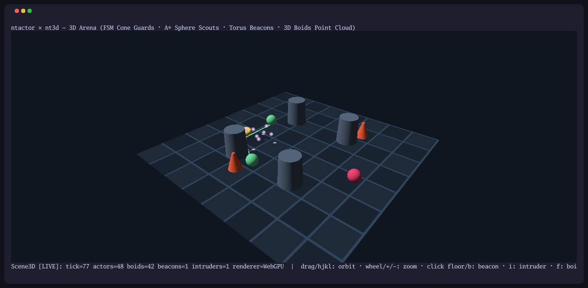
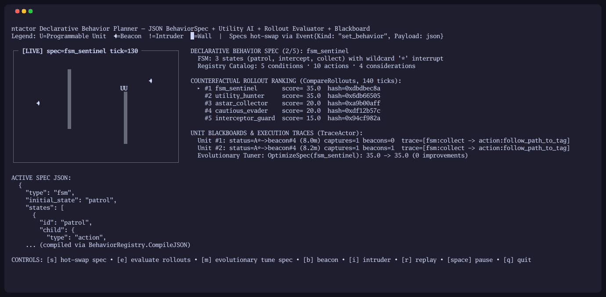
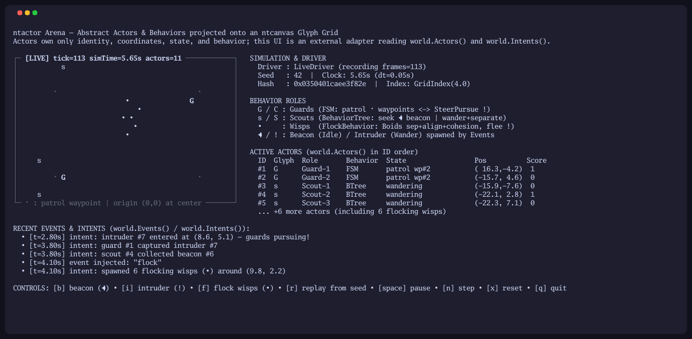
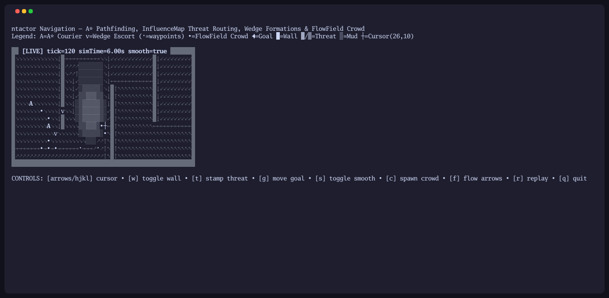
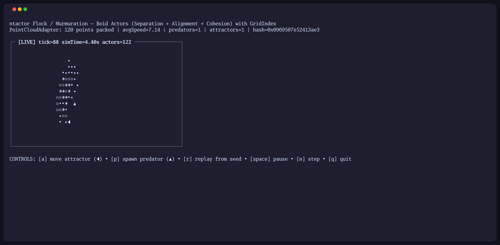

# ntactor — Deterministic Actors, Behaviors, Flocking & Pathfinding for Go

<p>
    <a href="https://github.com/NimbleTerminal/ntactor/actions/workflows/ci.yml"></a>
    <a href="https://github.com/NimbleTerminal/ntactor/tags"></a>
    <a href="https://pkg.go.dev/nimbleterminal.dev/ntactor?tab=doc"></a>
    <a href="https://github.com/NimbleTerminal/ntactor/blob/main/LICENSE"></a>
    <a href="https://github.com/NimbleTerminal/ntactor/blob/main/CODE_OF_CONDUCT.md"></a>
</p>

`ntactor` (`nimbleterminal.dev/ntactor`) is a self-contained, pure-Go library for classical game and simulation **Actors** and their **Behaviors** — finite state machines, behavior trees, Reynolds steering and Boids flocking, spatial hash indexing, A\* pathfinding, and Dijkstra flow fields.

[**Try out the live WASM demo.**](https://nimbleterminal.github.io/ntactor)

<p>
  <a href="https://nimbleterminal.github.io/ntactor/?demo=scene3d"></a>
  <a href="https://nimbleterminal.github.io/ntactor/?demo=planner"></a>
</p>
<p>
  <a href="https://nimbleterminal.github.io/ntactor/?demo=arena"></a>
  <a href="https://nimbleterminal.github.io/ntactor/?demo=nav"></a>
  <a href="https://nimbleterminal.github.io/ntactor/?demo=flock"></a>
</p>

Because the root module has **zero external dependencies** (Go standard library only), **no CGO**, and **never calls wall-clock APIs (`time.Now`) or global random generators**, every simulation run is 100% bit-deterministic across native (`linux`, `darwin`, `windows`, `freebsd`) and browser (`js/wasm`) targets.

Actors and the `World` own only identity, local state, abstract 2D/3D coordinates, and behavior. They know nothing about meshes, scene-graph nodes, terminal glyphs, or pixels. The same simulation drives:

- **Headless simulations and unit tests** — step thousands of ticks in microseconds and assert on `World.Hash()`.
- **Terminal & Bubble Tea games** — project `world.Actors()` onto an [`ntcanvas`](https://github.com/NimbleTerminal/ntcanvas) (`nimbleterminal.dev/ntcanvas`) glyph grid.
- **3D scene engines & point clouds** — sync `world.Actors()` into [`nt3d`](https://github.com/NimbleTerminal/nt3d) (`nimbleterminal.dev/nt3d`) scene-graph transforms or contiguous point-cloud buffers via a thin external adapter.

```sh
go get nimbleterminal.dev/ntactor@latest
```

## Quickstart

```go
package main

import (
	"fmt"

	actor "nimbleterminal.dev/ntactor"
)

type PatrolState struct {
	Speed float64
}

type myPatrolBehavior struct{}

func (myPatrolBehavior) Tick(dt float64, self *actor.Actor, world *actor.World) {
	st := self.State.(*PatrolState)
	self.Velocity = actor.Vec2(st.Speed, 0)
	actor.Integrate(self, dt)
}

func main() {
	world := actor.NewWorld(actor.Config{
		Seed:       42,
		Perception: actor.NewGridIndex(4.0),
	})

	id := world.Spawn(actor.Actor{
		Behavior: myPatrolBehavior{},
		State:    &PatrolState{Speed: 2.5},
	})

	driver := actor.NewLiveDriver(actor.LiveConfig{
		Seed:      42,
		DefaultDT: 1.0 / 60.0,
		Record:    true,
	})

	for range 60 {
		dt, events := driver.Step()
		world.Tick(dt, events)
		// An external adapter reads world.Actors() and world.Intents() here
		// to update terminal glyphs, nt3d scene nodes, or point clouds.
	}

	a := world.ActorByID(id)
	fmt.Printf("actor %d at (%.2f, %.2f) after %.2fs (hash=0x%016x)\n",
		a.ID, a.Position.X, a.Position.Y, world.SimTime(), world.Hash())
}
```

See [**`GUIDE.md`**](./GUIDE.md) for the complete developer guide covering the simulation contract, choosing and composing `FSM` / `BehaviorTree` / `UtilitySelector` / `GOAPNode` architectures, declarative JSON `BehaviorSpec` synthesis and evolutionary tuning, reciprocal collision avoidance, squad formations, 2D/3D pathfinding, and `InfluenceMap` routing.

## Demos & Sample Gallery

Building requires Go 1.26.8 or newer. See [`examples/README.md`](./examples/README.md) for full details:

- **`task run-arena`** ([`examples/arena`](./examples/arena/main.go)) — interactive multi-actor tactical arena with `FSM` perimeter guards (`SteerPursue` lead prediction), `BehaviorTree` resource scouts, Reynolds Boids wisps (`FlockBehavior`), live event injection (`b`: beacon, `i`: intruder, `f`: flock wisps), and instant `HistoricalDriver` replay from seed (`r`).
- **`task run-flock`** ([`examples/flock`](./examples/flock/main.go)) — Reynolds Boids murmuration (`FlockBehavior` + `GridIndex`) with dynamic attractors (`a`) and predators (`p`), adapted simultaneously to a contiguous 3D `PointCloudAdapter` slice and a terminal density grid.
- **`task run-nav`** ([`examples/nav`](./examples/nav/main.go)) — interactive A\* pathfinding (`FindWorldPath`), supercover line-of-sight path smoothing (`SmoothPath`), `InfluenceMap` threat-field stamping/diffusion (`t`), wedge squad escorts (`FollowLeaderBehavior`), weighted mud terrain (`░`), interactive wall toggling (`w`), goal relocation (`g`), and Dijkstra `FlowField` crowd steering (`c`).
- **`task run-scene3d`** ([`examples/scene3d`](./examples/scene3d/main.go)) — interactive 3D [`nt3d`](https://github.com/NimbleTerminal/nt3d) arena driving 3D cone guards (`FSM`), 3D sphere scouts (`BehaviorTree` + A\* path lines around 3D cylindrical pillars), spinning 3D torus beacons, and a 3D Boids murmuration point cloud (`SetNodeGeometry` / `PointStyle`) with mouse camera orbiting, ray-cast floor picking, and WebGPU/Software/Wireframe rendering.
- **`task run-planner`** ([`examples/planner`](./examples/planner/main.go)) — declarative JSON `BehaviorSpec` compiler (`BehaviorRegistry`) supporting `BehaviorTree`, `UtilitySelector`, `FSM`, and `GOAP` specs, per-Actor `Blackboard` and `ExecutionTrace` inspector (`TraceActor`), counterfactual rollout ranking (`CompareRollouts`), evolutionary parameter tuning (`OptimizeSpec`), and `EventLog` behavior hot-swapping.
- **`task run-replay`** ([`examples/replay`](./examples/replay/main.go)) — CLI verification demo recording a live simulation into an `EventLog`, round-tripping through JSON/binary codecs, replaying via `HistoricalDriver`, and asserting identical `World.Hash()` digests.
- **`task tapes`** ([`tapes/`](./tapes)) — records `arena`, `flock`, `nav`, `scene3d`, and `planner` GIFs (`dist/tapes/*.gif`) and README screenshots (`docs/images/*.png`) using [`ntrecord`](https://github.com/NimbleTerminal/ntrecord).

All five interactive examples compile to WebAssembly and run in the browser demo gallery via [`booba`](https://github.com/NimbleMarkets/go-booba), publishing their key bindings as interactive OSC 7501 action buttons above the terminal:

```sh
task serve-wasm-site   # builds web/demos/*.wasm, stages booba assets, serves http://localhost:8000/web/
```

`task build-wasm-site` alone produces the deployable `web/` directory and smoke-tests every compiled `.wasm` binary under Node; the `.github/workflows/pages.yml` workflow publishes `web/` to GitHub Pages on every push to `main`.

## Package Overview

| File | Types & Helpers | Purpose |
| --- | --- | --- |
| [`actor.go`](./actor.go) | `ActorID`, `Actor`, `Behavior`, `BehaviorFunc`, `IdleBehavior`, `Intent`, `Event` | Core actor identity, local state, behavior contract, emitted intents, and external events |
| [`world.go`](./world.go) | `World`, `Config`, `SpatialIndex` | Single simulation clock (`SimTime`), allocation-light `Tick`, `World.Hash()`, `Spawn`/`Destroy`, ID & tag queries, and radius/cone/LOS perception (`ActorsWithinRadius`, `Neighbors`, `ActorsWithinCone`, `HasLineOfSight`, `NearestActor`) |
| [`spatial.go`](./spatial.go) | `GridIndex`, `NewGridIndex` | Uniform 2D/3D spatial hash grid accelerating neighborhood queries while preserving deterministic `ActorID` order |
| [`rng.go`](./rng.go) | `RNG`, `RandomSource`, `NewRNG` | Seeded `xoshiro256**` PRNG, pluggable `RandomSource`, and per-actor streams (`World.ActorRNG`) |
| [`fsm.go`](./fsm.go) | `FSM`, `FSMState`, `Transition`, `StateID`, `WildcardState` | Deterministic Finite State Machine with `OnEnter`, `OnTick`, `OnExit`, and ordered conditional transitions |
| [`bt.go`](./bt.go) | `BehaviorTree`, `BTNode`, `Sequence`, `MemSequence`, `Selector`, `MemSelector`, `Parallel`, `Condition`, `Action`, `Invert`, `Cooldown`, `Timeout` | Stateless and stateful Behavior Tree composites, decorators, and leaves |
| [`utility.go`](./utility.go) | `UtilitySelector`, `UtilityOption`, `Consideration`, `ResponseCurve`, `ScoreConsiderations` | Classical Utility AI scoring candidate behaviors with normalized response curves (`linear`, `quadratic`, `sqrt`, `logistic`, `step`) |
| [`goap.go`](./goap.go) | `GOAPFact`, `GOAPAction`, `GOAPGoal`, `PlanGOAP`, `GOAPNode`, `NewGOAP` | Deterministic STRIPS / F.E.A.R.-style Goal-Oriented Action Planning over `Blackboard` preconditions and effects |
| [`blackboard.go`](./blackboard.go) | `Blackboard`, `BlackboardValue`, `WorldSnapshot`, `World.SnapshotJSON` | Sorted, deterministic key-value memory store on `World` and `Actor`, folded into `World.Hash()` |
| [`memory.go`](./memory.go) | `SensoryMemory`, `MemoryRecord`, `SenseKind`, `EmitSound`, `Actor.Memory` | Per-Actor sensory memory with last-known position/velocity extrapolation, confidence decay, and sound stimuli |
| [`spec.go`](./spec.go) | `BehaviorSpec`, `BehaviorRegistry`, `NewStandardRegistry`, `EvaluateRollout`, `CompareRollouts` | Declarative JSON behavior compiler, schema catalog (`CatalogJSON`), `Event`-driven behavior hot-swapping, and headless counterfactual rollout evaluator |
| [`steering.go`](./steering.go) | `Vec3`, `Vec2`, `SteerSeek`, `SteerFlee`, `SteerArrive`, `SteerPursue`, `SteerEvade`, `SteerWander`, `SteerSeparation`, `SteerAlignment`, `SteerCohesion`, `SteerAvoidCircles`, `SteerAvoidActors`, `FormationOffsets`, `FollowLeaderBehavior`, `FlockBehavior`, `PatrolBehavior`, `WanderBehavior` | Abstract 2D/3D vector kinematics, reciprocal obstacle avoidance, squad formations, and Reynolds Boids flocking |
| [`nav.go`](./nav.go) | `NavGraph`, `NodeID`, `FindPath`, `FindPathNodes`, `GridMap`, `FlowField`, `WaypointGraph`, `VoxelGrid`, `FollowPathBehavior`, `FlowFieldBehavior` | Deterministic 2D/3D A\* pathfinding, line-of-sight path smoothing, weighted occupancy grids, and Dijkstra flow fields |
| [`influence.go`](./influence.go) | `InfluenceMap`, `NewInfluenceMap`, `NewInfluenceMapFromGrid`, `SteerInfluence` | Deterministic 2D threat & pheromone fields with LOS-occluded stamping, wall-aware decay/diffusion, gradient steering, and `GridMap` cost coupling |
| [`driver_live.go`](./driver_live.go) | `LiveDriver`, `LiveConfig`, `Frame`, `EventLog`, `Driver` | Accumulates wall time (variable clamped `dt` or fixed `FixedDT`), injects live events, and records an `EventLog` |
| [`driver_historical.go`](./driver_historical.go) | `HistoricalDriver` | Replays a recorded `EventLog` or scripted `[]Frame` sequence for bit-exact historical determinism |
| [`checkpoint.go`](./checkpoint.go) | `WorldCheckpoint`, `World.Checkpoint`, `World.Restore`, `World.Clone`, `EncodeCheckpointJSON`, `DecodeCheckpointJSON` | Mid-simulation state checkpointing, rollback/rewind, deep `World` cloning, and live rollout branching |
| [`codec.go`](./codec.go) | `EncodeEventLogJSON`, `DecodeEventLogJSON`, `MarshalEventLogBinary`, `UnmarshalEventLogBinary` | Bounded JSON and compact binary serialization for recorded `EventLog` replays |

## Decision Making: FSM & Behavior Trees

Every `Behavior` implements a single method:

```go
type Behavior interface {
    Tick(dt float64, self *Actor, world *World)
}
```

### Finite State Machines (`FSM`)

`FSM` evaluates transitions in registration order before calling the active state's `OnTick` hook, with `WildcardState` (`"*"`) for global interrupts:

```go
fsm := actor.NewFSM("patrol")
fsm.AddState("patrol", actor.FSMState{
    OnTick: patrol.Tick,
})
fsm.AddState("intercept", actor.FSMState{
    OnEnter: func(self *actor.Actor, _ *actor.World) {
        self.Emit(actor.Intent{Kind: "alert"})
    },
    OnTick: func(dt float64, self *actor.Actor, world *actor.World) {
        if target := world.NearestActor(self.Position, 20.0, self.ID); target != nil {
            desired := actor.SteerPursue(self, target, 0.8, 10.0)
            actor.ApplySteering(self, desired, 25.0, 10.0, dt)
        }
    },
})
fsm.AddTransition("patrol", "intercept", func(_ *actor.Actor, w *actor.World) bool {
    return len(w.FindByTag("intruder")) > 0
})
```

### Behavior Trees (`BehaviorTree`)

Combine stateless reactive nodes (`Sequence`, `Selector`, `Condition`, `Action`, `Invert`) with stateful nodes (`MemSequence`, `MemSelector`, `Parallel`, `Cooldown`, `Timeout`):

```go
bt := actor.NewBehaviorTree(actor.Selector(
    actor.Cooldown(2.0, attackSequence),
    actor.Timeout(5.0, searchAction),
    wanderAction,
))
```

### Utility AI (`UtilitySelector`) & Goal-Oriented Action Planning (`GOAPNode`)

- **`UtilitySelector`** scores candidate `UtilityOption` branches using normalized `ResponseCurve` considerations (`CurveLinear`, `CurveQuadratic`, `CurveSqrt`, `CurveLogistic`, `CurveStep`) with geometric-mean compensation so multi-consideration options aren't penalized.
- **`GOAPNode` & `PlanGOAP`** perform deterministic A\* state-space search over `Blackboard` preconditions and effects (`FactBool`, `FactFloat`, `FactInt`, `FactString`) to synthesize multi-step action plans toward the highest-priority unsatisfied `GOAPGoal`, automatically replanning when world facts change.

### Declarative `BehaviorSpec`, Counterfactual Rollouts & Evolutionary Tuning

Compile, inspect (`TraceActor`), hot-swap (`RegisterSwapHandler`), rank (`CompareRollouts`), and evolutionarily tune (`OptimizeSpec`) JSON-serializable `BehaviorSpec` ASTs spanning `BehaviorTree`, `UtilitySelector`, `FSM`, and `GOAP`:

```go
reg := actor.NewStandardRegistry(actor.StandardRegistryConfig{
    GridMap:      gm,
    InfluenceMap: im,
})
bt, err := reg.CompileJSON(specJSON)

// Evaluate or evolutionarily tune candidate specs in fast headless rollouts:
opt := actor.OptimizeSpec(baseCfg, 6, 4, 0.25)
bestBT, _ := reg.Compile(opt.Best.Spec)
```

## Steering, Avoidance, Formations, Boids Flocking & Spatial Indexing

Attach `NewGridIndex(cellSize)` to `Config.Perception` to accelerate `Neighbors`, `ActorsWithinRadius`, `ActorsWithinCone`, and `NearestActor` from $O(N)$ to uniform 2D/3D spatial grid lookups while preserving deterministic `ActorID` ordering.

- **Reciprocal Collision Avoidance (`SteerAvoidActors`)** — time-to-closest-approach velocity avoidance so Actors passing through narrow doorways or bi-directional corridors deflect smoothly without colliding.
- **Squad & Leader Formations (`FormationOffsets`, `FollowLeaderBehavior`)** — `FormationWedge`, `FormationLine`, `FormationColumn`, and `FormationRing` slot offsets rotated dynamically by a leader Actor's heading.
- **Reynolds Boids (`FlockBehavior`)** — combines **Separation**, **Alignment**, and **Cohesion** with optional target attraction (`AttractTag`), predator evasion (`RepelTag`), wander jitter, and soft boundary containment:

```go
world.Spawn(actor.Actor{
    Tag:      "boid",
    Position: actor.Vec3{X: 4, Y: -2, Z: 1},
    Behavior: &actor.FlockBehavior{
        NeighborRadius:   4.5,
        SeparationRadius: 1.8,
        SeparationWeight: 1.8,
        AlignmentWeight:  1.1,
        CohesionWeight:   1.0,
        MaxSpeed:         8.0,
        MaxForce:         20.0,
        SameTagOnly:      true,
        AttractTag:       "attractor",
        RepelTag:         "predator",
        RepelRadius:      7.5,
        RepelWeight:      3.5,
    },
})
```

## Pathfinding, 3D Navigation, Flow Fields & Influence Maps

- **`NavGraph` & `FindPathNodes` / `FindPath`** — interface-based deterministic A\* search over any custom waypoint or navmesh graph, breaking f-score ties by `NodeID`.
- **`GridMap`** — 2D occupancy and weighted-cost grid (`SetWall`, `SetRectWall`, `SetCost`) with 8-connected movement, diagonal corner-clipping prevention, supercover Bresenham `HasLineOfSight` (compatible with `Config.LineOfSight`), string-pulling `SmoothPath`, and one-call `FindWorldPath` + `FollowPathBehavior`.
- **3D Navigation (`WaypointGraph`, `VoxelGrid`)** — arbitrary 3D waypoint/portal graphs and 3D 26-connected volumetric voxel grids with 3D `HasLineOfSight`, `SmoothPath`, and `FindWorldPath`.
- **`FlowField` & `FlowFieldBehavior`** — single-pass Dijkstra integration field computed toward a goal cell (`FlowField.Compute`), enabling hundreds of crowd Actors to steer around walls and high-cost terrain with zero per-actor A\* replanning overhead.
- **Spatial Influence & Pheromone Maps (`InfluenceMap`)** — deterministic 2D threat, tactical control, and stigmergic pheromone fields with LOS-occluded radial stamping (`StampRadiusWithLOS`), wall-aware decay and 4-neighbor diffusion (`StepWithWalls`), gradient steering (`SteerInfluence`), and direct `GridMap` cost coupling (`ApplyCostToGridMap`):

```go
gm := actor.NewGridMap(50, 20, 1.0, actor.Vec2(0, 0))
gm.SetRectWall(20, 0, 20, 14, true)

// Stamp a threat zone and couple it into GridMap A* / FlowField traversal costs:
im := actor.NewInfluenceMapFromGrid(gm)
im.StampRadiusWithLOS(actor.Vec2(30.5, 10.5), 5.0, 10.0, gm)
im.ApplyCostToGridMap(gm, 1.0, 3.0)

path, ok := gm.FindWorldPath(actor.Vec2(2.5, 2.5), actor.Vec2(45.5, 10.5), true)
follow := &actor.FollowPathBehavior{Path: path, Speed: 6.0, MaxForce: 30.0, ArrivalRadius: 0.4}
```

## Live vs. Historical Replay

External inputs (player commands, network messages, scripted spawns) enter the simulation only as `Event` values passed into `World.Tick(dt, events)`.

`LiveDriver` records every `(dt, events)` frame into an `EventLog` without taking expensive state snapshots. Serialize that `EventLog` with `EncodeEventLogJSON` or `MarshalEventLogBinary`, and feed it into `HistoricalDriver` on a fresh `World` initialized with the same `Seed` to reproduce the exact simulation state (`World.Hash()`) at every tick:

```go
// 1. Record a live run:
live := actor.NewLiveDriver(actor.LiveConfig{Seed: 42, Record: true})
live.PushEvent(actor.Event{Kind: "spawn_intruder", Vector: actor.Vec2(4, -2)})
dt, events := live.Step()
liveWorld.Tick(dt, events)

// 2. Serialize or replay deterministically in historical mode:
data, _ := actor.MarshalEventLogBinary(live.Log())
log, _ := actor.UnmarshalEventLogBinary(data, 0)

replayWorld := actor.NewWorld(actor.Config{Seed: log.Seed})
hist := actor.NewHistoricalDriver(log)
for !hist.Done() {
	dt, events := hist.Step()
	replayWorld.Tick(dt, events)
}
// replayWorld.Hash() == liveWorld.Hash()
```

## Adapter Boundary

`ntactor` never imports a renderer. Instead, your adapter inspects `world.Actors()` and `world.Intents()` after `world.Tick`:

```go
// Terminal glyph adapter (e.g. ntcanvas):
for _, a := range world.Actors() {
	grid.SetText(ntcanvas.Point{X: int(a.Position.X), Y: int(a.Position.Y)}, glyphFor(a))
}

// 3D scene-graph or point-cloud adapter (e.g. nt3d):
for _, a := range world.Actors() {
	scene.SetNodePosition(nodeName(a.ID), a.Position.X, a.Position.Y, a.Position.Z)
}
```

## Known Caveats

- **WASM workspace (`wasm.work`).** `wasm.work` selects the Bubble Tea fork with browser `booba` bridge support; native builds use the upstream dependency in `examples/go.mod` (`GOWORK=off`). The WASM tasks (`task build-wasm-site`, `task serve-wasm-site`, `task test-wasm`) and CI select this workspace automatically.
- **Deterministic map avoidance.** Never iterate over Go `map` values inside custom `Behavior.Tick` implementations if iteration order can affect actor state, velocity, or RNG draws. Use `world.Actors()`, `world.FindByTag()`, or `world.Neighbors()`, which always return slices in ascending `ActorID` order.

## Contributing

Use Go 1.26.8+ and [Go Task](https://taskfile.dev). Run `task ci` to check formatting, module tidiness, race-detector tests, `go vet`, cross-platform builds (`windows`, `linux`, `darwin`, `freebsd`, `js/wasm`), and example binaries.

Contributions and feedback are welcome. Please follow our [Code of Conduct](CODE_OF_CONDUCT.md).

- [Report an issue](https://github.com/NimbleTerminal/ntactor/issues)
- [Submit a pull request](https://github.com/NimbleTerminal/ntactor/pulls)

## License

[MIT License](./LICENSE) — Copyright (c) 2026 [Neomantra Corp](https://www.neomantra.com).

----
Made with :heart: and :fire: by the team behind [Nimble.Markets](https://nimble.markets).
